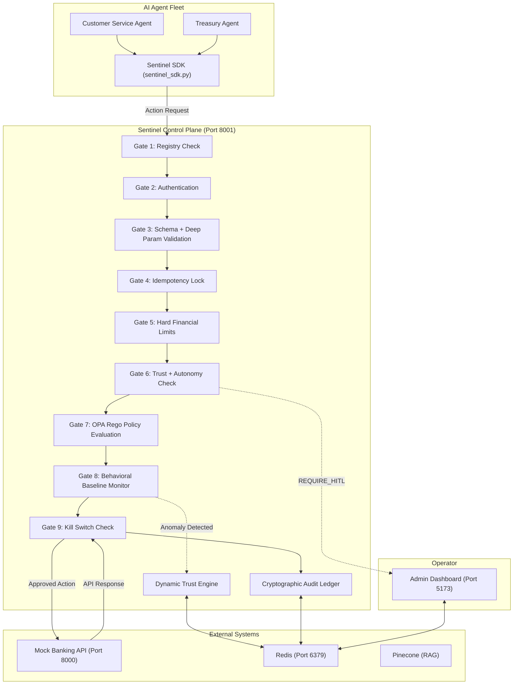

# System Architecture

Sentinel is a Zero Trust Governance Control Plane designed to sit inline between autonomous AI agents and core financial APIs. Instead of allowing LLM agents to call payment APIs directly, Sentinel forces all agents to route their actions through a 9-gate interception pipeline. Every action is cryptographically audited, behaviorally monitored, and policy-checked before it reaches the real world.

## High Level Architecture

## Core Components

### 1. `safety-service` (The Control Plane)

**Tech**: FastAPI + Python

**Port**: 8001

**Role**: The core brain of Sentinel. It exposes the governance API endpoints that the SDK calls. It implements the full 9-gate pipeline, runs the Trust Engine, executes OPA policy evaluation, maintains behavioral baselines in Redis, manages the cryptographic audit ledger, and streams live telemetry to the frontend dashboard.

Key files: `main.py`, `agent_registry.py`, `trust_engine.py`, `behavior_monitor.py`, `kill_switch.py`, `rag_firewall.py`

### 2. `agents-fleet` (The Autonomous Actors)

**Tech**: Python + LangChain + Groq LLMs

**Role**: Specialized AI agents that interpret natural language requests and attempt to execute financial actions. No agent holds direct API credentials to the banking backend. Every tool call is wrapped through the Sentinel SDK, which intercepts and routes the action through the governance pipeline.

Key files: `sentinel_sdk.py`, `customer_service_agent.py`, `treasury_agent.py`

### 3. `mock-banking-api` (The Financial Backend)

**Tech**: FastAPI + Python

**Port**: 8000

**Role**: A simulated banking backend that handles account lookups, transaction history retrieval, fee waivers, eligibility checks, and wire transfers. It only receives requests that have already passed through the complete Sentinel governance pipeline.

### 4. `frontend` (The Operator Dashboard)

**Tech**: React 18, TypeScript, TanStack Router, Recharts, TailwindCSS, Vite

**Port**: 5173

**Role**: A real-time control panel where human operators monitor agent trust scores and autonomy tiers, watch live governance telemetry, approve or reject HITL escalations, manage agent registrations, view and edit OPA policies, and browse the cryptographic audit log. The Demo Sandbox at `/demo` connects directly to the live agents and streams the gate-by-gate decision trail in real time.

### 5. Redis (The State Store)

**Port**: 6379 (Docker container)

**Role**: Powers all distributed state in the system. Holds live trust scores per agent, idempotency keys with TTL windows, behavioral baseline profiles, kill switch flags, and the agent registry.

### 6. Pinecone (The Vector Store)

**Role**: Stores trusted policy document embeddings for RAG retrieval. The Safety Service verifies every retrieved chunk against its registered SHA-256 hash before allowing it to be used in agent context. This prevents RAG poisoning attacks.

## Data Flow: From Intent to Execution

1. A user submits a request through the Demo Sandbox or directly to an agent.
2. The agent uses LangChain to reason about the request and decides to call a specific tool.
3. The tool is a wrapper around `execute_governed_tool()` in the Sentinel SDK.
4. The SDK calls the Safety Service with the agent identity, action type, and parameters.
5. The Safety Service runs the request through the 9-gate pipeline sequentially.
6. If all gates pass, Sentinel forwards the request to the Mock Banking API.
7. The API response is returned to the agent.
8. The entire decision trail (every gate result, trust score before and after, final decision) is hashed and appended to the cryptographic audit ledger.
9. The live telemetry stream pushes all events to the frontend dashboard in real time.
